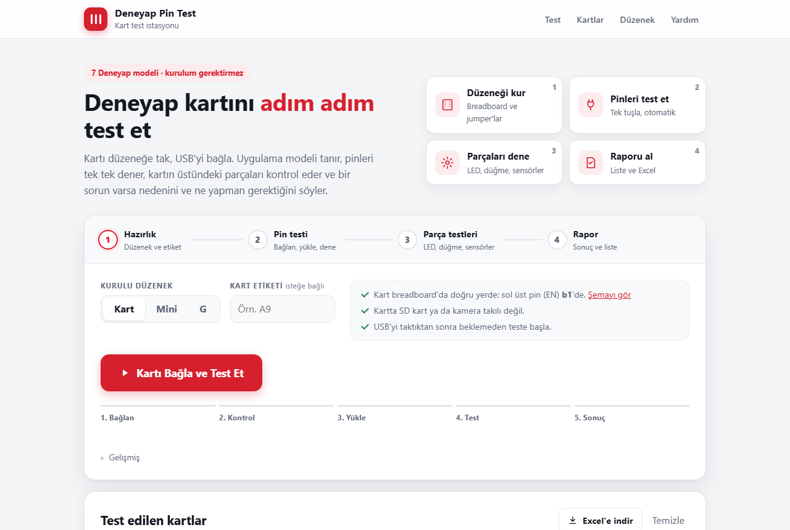

# Deneyap Pin Test

[](https://github.com/halit-bbektas/deneyap-pin-test/actions/workflows/testler.yml)

Deneyap geliştirme kartlarının bozuk pinlerini tarayıcıdan, tek tuşla bulan test uygulaması.

**Uygulamayı açın:** https://halit-bbektas.github.io/deneyap-pin-test/ (Chrome ya da Edge ile)



Kart USB'ye takılır, **"Kartı Bağla ve Test Et"** düğmesine basılır. Uygulama:

1. kartın işlemcisini ve modelini tanır,
2. kartta test yazılımı yoksa ya da eskiyse onu karta kendisi yükler,
3. test düzeneğindeki pinleri gruplar hâlinde birbirine sinyal göndererek dener,
4. sonucu kartın pin şeması üzerinde yeşil/kırmızı gösterir ve test edilen kartları listeler (Excel'e indirilebilir).

## Gereksinimler

- Bilgisayarda **Google Chrome** ya da **Microsoft Edge** (Web Serial desteği gerekir).
- Deneyap Kart ve Deneyap Kart 1A için Windows'ta [CP210x sürücüsü](https://www.silabs.com/developers/usb-to-uart-bridge-vcp-drivers).
- Breadboard (830 delik) ve erkek-erkek jumper ile kurulmuş test düzeneği (şeması uygulamada).

## Desteklenen kartlar

| Kart | İşlemci | Düzenek | Donanımda denendi |
| --- | --- | --- | --- |
| Deneyap Kart | ESP32 | Kart | Evet |
| Deneyap Kart 1A | ESP32 | Kart | Evet |
| Deneyap Kart v2 | ESP32-S3 | Kart | Evet |
| Deneyap Kart 1A v2 | ESP32-S3 | Kart | Hayır |
| Deneyap Mini | ESP32-S2 | Mini | Hayır |
| Deneyap Mini v2 | ESP32-S2 | Mini | Hayır |
| Deneyap Kart G | ESP32-C3 | G | Hayır |

Pin konumları Deneyap'ın resmî pin diyagramlarından ve kart tanım dosyalarından alınmıştır.

## Parça testleri

Pin testinden sonra kartın üstündeki parçalar modele göre denenir (komut `B:<düzenek>:<test>`, kaynak `firmware-src/dpt_esp32/bilesen.ino`):

| Test | Nasıl | Modeller |
| --- | --- | --- |
| İşlemci, flash | Otomatik; fiziksel flash boyutu modelle karşılaştırılır | Hepsi |
| PSRAM | Otomatik; 4 MB'a kadar yazma/okuma | Deneyap Kart, 1A, Mini v2 |
| Wi-Fi ve anten | Otomatik; ağ taraması ve sinyal gücü | Hepsi |
| Sıcaklık ölçer | Otomatik | v2, 1A v2, Mini, Mini v2, G |
| Hareket sensörü (LSM6DSM) | Otomatik; WHO_AM_I, ölçüm ve sensörün öz-testi | Deneyap Kart, v2 |
| RGB LED | Her renk yakılır, kullanıcı onaylar | Hepsi |
| BUT düğmesi | Kullanıcının basması beklenir | Hepsi |
| Mikrofon (MP34DT05) | El çırpma sesi ölçülür | Deneyap Kart |

Her sorunlu parça için uygulama olası sebebi ve yapılacakları gösterir. Hareket sensörü testleri Deneyap Kart v2 ile doğrulandı (öz-test farkı ivme 265–618 mg, jiroskop 380–429 dps; veri sayfası sınırları 90–1700 mg ve 150–700 dps). Mikrofon testi henüz gerçek kartla doğrulanmadığı için "arızalı" yerine en fazla "kontrol et" sonucu verir.

## Güvenlik

Kart açılışta pinlere dokunmaz. Uygulama kurulu düzeneği (`T:kart`, `T:mini`, `T:g`) bildirir; düzenek kartın modeline uymuyorsa test yazılımı hiçbir pine sinyal vermez. Yanlış düzenekte bazı jumper'lar GPIO'yu 3V3 ya da GND'ye bağlayabileceği için bu kontrol önemlidir.

Bozuk kartlar için:

- Test sinyali en düşük akım ayarıyla (`GPIO_DRIVE_CAP_0`) verilir; pin kartta GND'ye, 3V3'e ya da başka bir pine kısa devreyse akım sınırlı kalır.
- Pinler sürülmeden önce okunur. GND'ye ya da 3V3'e sabitlenmiş bir grup ayrıca raporlanır ve kısa devre testinde yanlış alarm üretmez.
- İki grup arasındaki bir köprü tek kısa devre olarak raporlanır.
- Kart v2 ile 1A v2 dahili IMU'ya ve flash boyutuna (8 MB / 4 MB) göre ayrılır; IMU'su cevap vermeyen bir v2 yanlış pin tablosuyla test edilmez, IMU ayrıca raporlanır.

Bu durumlar `firmware-src` dışındaki bir taklit katmanıyla (kopuk pin, GND/3V3 kısa devresi, gruplar arası köprü, kablosuz grup, düzeneksiz kart, cevapsız IMU) Kart 1A ve Kart v2 üzerinde denenmiştir.

## Geliştirme

Test yazılımının tek kaynağı `firmware-src/dpt_esp32/` klasöründedir; dört işlemci için ayrı derlenir. Deneyap Kart IDE ile gelen `arduino-cli` kullanılabilir:

```bash
CLI="arduino-cli --config-file ~/.deneyapkart-ide/arduino-cli.yaml"
$CLI compile --fqbn "deneyap:esp32:deneyapkart1A:PSRAM=enabled" --output-dir build/esp32 firmware-src/dpt_esp32
$CLI compile --fqbn "deneyap:esp32:deneyapkart1Av2:PSRAM=disabled,FlashMode=dio" --output-dir build/s3 firmware-src/dpt_esp32
$CLI compile --fqbn deneyap:esp32:deneyapminiv2 --output-dir build/s2 firmware-src/dpt_esp32
$CLI compile --fqbn deneyap:esp32:deneyapkartg --output-dir build/c3 firmware-src/dpt_esp32
python tools/kirp.py build/esp32/dpt_esp32.ino.merged.bin firmware/dpt_esp32.bin
python tools/kirp.py build/s3/dpt_esp32.ino.merged.bin firmware/dpt_esp32s3.bin
python tools/kirp.py build/s2/dpt_esp32.ino.merged.bin firmware/dpt_esp32s2.bin
python tools/kirp.py build/c3/dpt_esp32.ino.merged.bin firmware/dpt_esp32c3.bin
```

Test yazılımı değiştiğinde `FW_SURUM` ile `firmware/manifest.json` içindeki `surum` birlikte artırılır; uygulama kartlardaki eski sürümü otomatik günceller.

### Testler

Kartın gönderdiği sonucu çözen kod, kart ve düzenek bilgileri `cekirdek.js` dosyasındadır; testleri tarayıcı ya da kart gerektirmez:

```bash
npm test
```

Testler sonuç satırlarının çözülmesini, Türkçe çevirileri, düzeneklerde aynı pinin iki kez ya da bir güç pininin kullanılmamasını, test yazılımındaki pin gruplarının uygulamadaki düzeneklerle birebir aynı olmasını ve `manifest.json` dosyasını denetler. Her gönderimde GitHub Actions ile otomatik çalışır.

Karta yükleme Espressif'in [esptool-js](https://github.com/espressif/esptool-js) kütüphanesiyle yapılır (Apache-2.0, `lib/` klasöründe).

## Katkıda bulunma

Hata bildirimi için **Issues → Hata bildirimi** şablonunu, kullanım soruları için **Discussions → Q&A** bölümünü kullanın. Kod göndermeden önce [CONTRIBUTING.md](CONTRIBUTING.md) dosyasına bakın.

## Lisans

[MIT](LICENSE) © 2026 Halit Büyükbektaş. `lib/` klasöründeki esptool-js kendi [Apache-2.0](lib/esptool-js-LICENSE.txt) lisansıyla dağıtılır.
